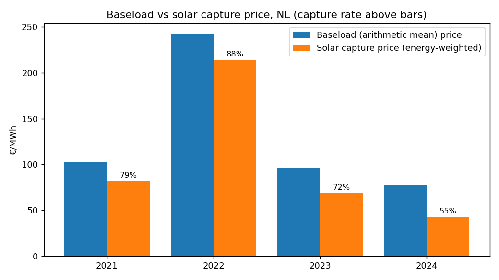
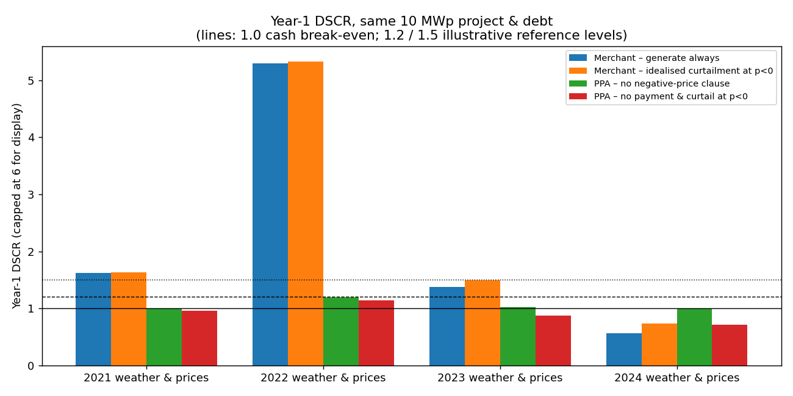

# Solar revenue and financing risk in the Netherlands

*An independent learning project using public Dutch energy and weather data.*

> This project is **not affiliated with, commissioned by, or endorsed by any bank**. It was inspired
> by publicly reported financing of Dutch solar projects (see [sources](docs/sources.md)) and does
> not represent any bank's internal methods, data or lending decisions. The solar park is hypothetical.

## Motivation and question

Banks finance solar parks with loans that are repaid from the electricity the park sells. I wanted
to understand what makes that cash flow risky, and to see how far I could get with public data and
a statistics background.

**Central question:** how do solar production and electricity market prices affect the revenue and
financing risk of a hypothetical Dutch solar project?

## Data

- **Solar production:** hourly estimates from PVGIS 6 and PVGIS 5.3 (European Commission, Joint
  Research Centre) for a site in Flevoland, 2021–2024.
- **Weather observations:** KNMI weather stations Lelystad and Marknesse, used to check timing and
  consistency.
- **Electricity prices:** Dutch day-ahead market prices from Energy-Charts (Fraunhofer ISE; data from
  Bundesnetzagentur | SMARD.de, CC BY 4.0).
- **Costs and financing assumptions:** the Dutch government's public cost study for solar subsidies
  (PBL, *SDE++ 2025*).

Raw data are not included; the scripts download them. Attribution and terms: [docs/sources.md](docs/sources.md).

## Method in brief

1. **Validate the data:** align everything to UTC, check completeness, units, time stamps and
   missing values, and compare the two production models.
2. **Analyse revenue:** combine hourly production with hourly prices to see what a solar park
   actually earns.
3. **Illustrate financing risk:** build a simple annual cash-flow model for a hypothetical 10 MWp park
   and compare selling at market prices with a fixed-price contract.

## Findings

### A. Data quality and validation

- The price and production series cover every hour of 2021–2024 (35,064 hours) with no duplicates;
  PVGIS 6 has 33 hours without values, and PVGIS 5.3 does not cover 2024.
  Converting to local time reproduces exactly the eight daylight-saving changes.
- PVGIS 6 returns its values without timestamps. The rebuilt time index was checked row by row
  against PVGIS's own timestamped output for every year: identical.
- **PVGIS 5.3 reports zero irradiance and zero production for 26 daytime hours** that cannot be
  real: an independent sun-position calculation puts the sun 10.2°–60.6° above the horizon (hourly
  average), and the nearest KNMI station measured daylight irradiance in every one of them. PVGIS 6
  reports the same 26 hours as missing, which suggests missing satellite input; PVGIS 5.3 does not
  mark them as missing.
- The two PVGIS versions differ by about 4 % in annual energy even though the sunlight input is the
  same; most of the difference comes from updated solar-module parameters. This is model
  uncertainty, carried as a sensitivity case.

### B. Solar production and electricity prices

Solar parks all produce at the same time, so prices tend to be lowest exactly when they produce. The
**capture price**, the production-weighted average price a park actually receives, is therefore below
the simple average market price. The gap equals the covariance between production and price divided
by average production.

- Capture rate (capture price ÷ average price): **79 % (2021), 88 % (2022), 72 % (2023), 55 % (2024)**.
  In 2024 the average price was €77/MWh, but a south-facing system at this site would have received €42/MWh.
- In 2024, **20 % of the system's output was produced in hours with negative prices**, up from 3 % in 2021.
- Year-to-year revenue changes were driven far more by prices than by weather (6–13 times more in
  2021–2024, a period that included the 2022 energy crisis).



### C. Illustrative financing risk

Lenders often look at the **debt service coverage ratio (DSCR)**: the cash a project has left after
operating costs and tax, divided by the loan payment due that year. A DSCR of 1.0 means the cash just
covers the payment; lenders typically want a buffer above that.

Using the same hypothetical park, costs and loan, and changing only how the electricity is sold, each
historical year was replayed as the park's first operating year:

- **Selling at market prices**, the first-year DSCR ranged from 0.56 (2024 conditions) to 5.29 (2022
  conditions).
- **With a fixed-price contract (PPA) at an illustrative €60/MWh**, it ranged from 0.99 to 1.19.

A fixed-price contract can reduce revenue uncertainty, but whether the loan is covered still depends
on production, costs, contract terms and the amount of debt. With 80 % debt, the first-year DSCR
reaches 1.2 at a contract price of about €60–67/MWh. If that price stays fixed while costs rise and
panel output slowly declines, the ratio falls over the 15-year loan: at €60/MWh, to about 0.7–0.9 in
the final years. Stress tests, break-even prices and debt-sizing
calculations are in the [financing report](reports/stage3/STAGE3_REPORT.md).



## Assumptions and limitations

- **Hypothetical project.** The park, site and orientation (35°, south) are assumptions. Production
  is modelled, not measured.
- **Prices are from a single source.** Energy-Charts data passed the completeness and time checks
  but have **not been independently cross-checked against the official ENTSO-E data**. The comparison
  is implemented and runs once an ENTSO-E API token is available (steps in
  [Methods and limitations](docs/METHODS_AND_LIMITATIONS.md#6-price-data-validation-status)).
- **Financing assumptions come from a study of subsidised projects** (80 % debt, 4 % interest,
  15 years); the subsidy itself is excluded. The 80 % is therefore used as a reference, and the
  report focuses on break-even prices and the amount of debt each case can support.
- **The PPA price is illustrative.** No verified Dutch contract-price benchmark was found.
- **Four years are four very different markets** (including the 2022 energy crisis). They are used as
  historical "what if" replays, not as forecasts. A predictive model was considered and not built,
  because the available data were judged insufficient for a reliable one ([why](docs/METHODS_AND_LIMITATIONS.md#7-why-no-predictive-model-was-built)).
- **A DSCR below 1 is not a default.** It means cash did not cover the payment in that year; no default
  probabilities are estimated.

## Reproduce

Tested with Python 3.13. The first run needs internet access (downloads are cached in `data/raw/`).

```bash
pip install -r requirements.txt
python scripts/run_stage1_audit.py       # download + data audit
python scripts/build_audit_report.py
python scripts/run_stage1_review.py      # timestamp checks, PVGIS version comparison
python scripts/run_stage2_analysis.py    # capture prices and revenue
python scripts/build_stage2_report.py
python scripts/run_stage3_model.py       # cash flow, DSCR, stress tests
python scripts/build_stage3_report.py
python scripts/check_data_sufficiency.py # optional, ~7 min: 2015–2024 data-sufficiency check
python -m pytest -q
```

Every download is logged with a SHA-256 hash in `data/raw/manifest.jsonl`. Reports are generated
from the result files by the build scripts; a few descriptive values (such as the assumed system
size) are written into the report text.

## Reports

| Report | Content |
|---|---|
| [Data audit](reports/data_audit/AUDIT_REPORT.md) | Completeness, time alignment, missing values, source comparison |
| [Data review](reports/data_audit/STAGE1_REVIEW.md) | Timestamp verification, why PVGIS versions differ |
| [Revenue analysis](reports/stage2/STAGE2_REPORT.md) | Capture prices, negative prices, seasonality, sensitivity |
| [Financing analysis](reports/stage3/STAGE3_REPORT.md) | Cash flow, DSCR, stress tests, break-even prices, debt sizing |
| [Methods and limitations](docs/METHODS_AND_LIMITATIONS.md) | Assumptions, corrections, validation status |

## Repository

```
configs/        site, system and financing assumptions (each with value, status and source)
src/solarrisk/  data ingestion, validation, revenue analysis, finance calculations
scripts/        one script per analysis step, plus report builders
tests/          unit tests (units, time alignment, formulas) and checks on the real data
reports/        generated reports, result files and figures
docs/           methods and limitations, sources and attribution
```

## License

The project code is released under the [MIT License](LICENSE). The license does not cover
third-party data: raw data are not redistributed in this repository and remain subject to their
providers' terms (see [docs/sources.md](docs/sources.md)).
