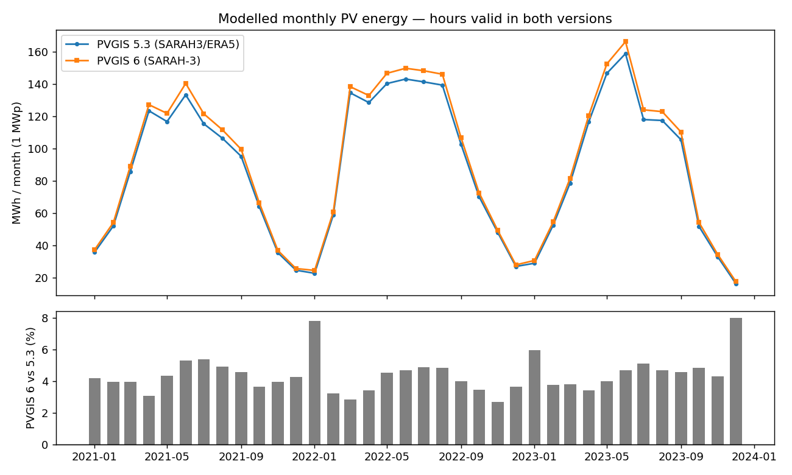
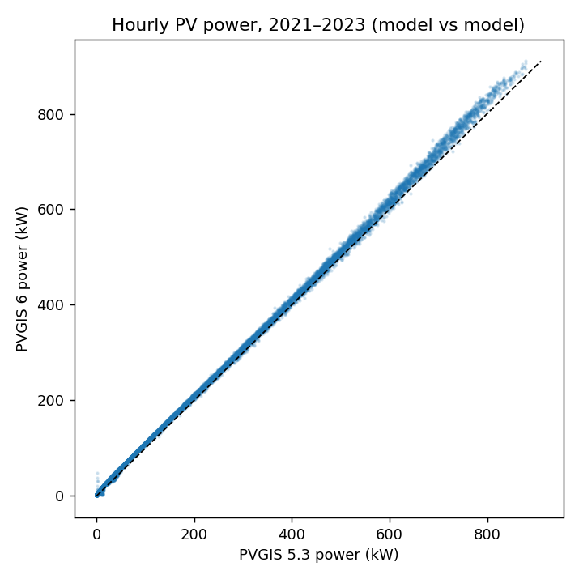
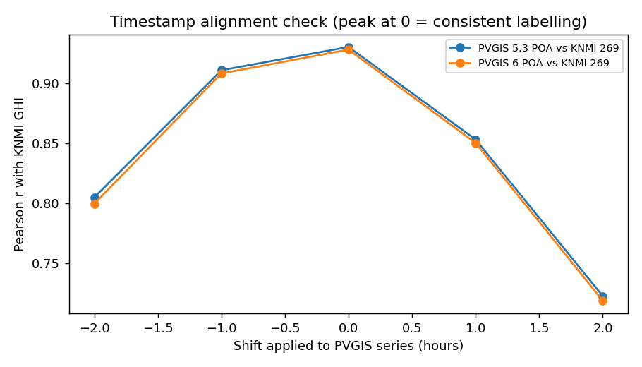
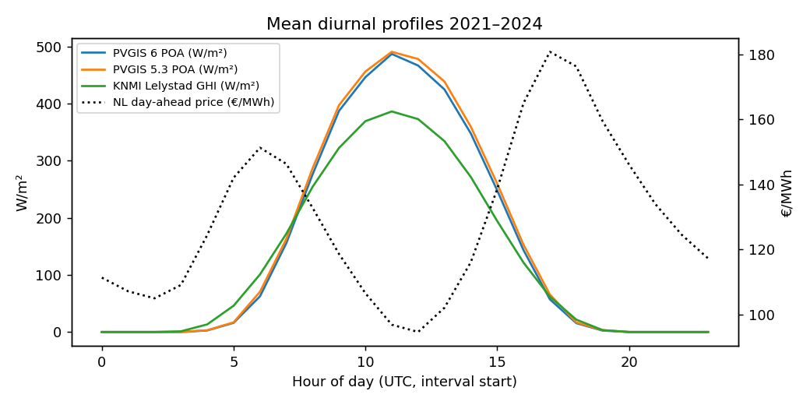
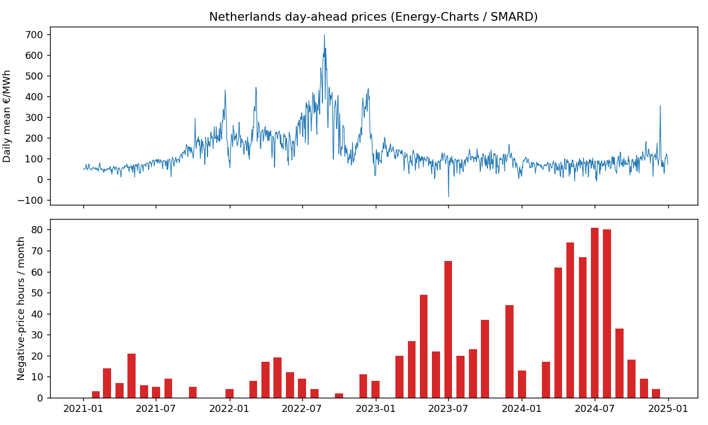

# Stage 1 — Data Feasibility Audit

_Generated 2026-11-15 by `scripts/build_audit_report.py` from `data_quality.json`. All figures below are computed from data actually retrieved; nothing is synthetic._

Site (hypothetical): 52.45° N, 5.70° E (Biddinghuizen, Flevoland). Test system: 1,000 kWp, 14 % system loss, 35° tilt, south-facing. Period: 2021–2024 (35,064 expected UTC hours).

## 1. Retrieval status

| Source | Year | OK | HTTP | Error |
|---|---|---|---|---|
| pvgis53 | 2021 | ✅ | 200 |  |
| pvgis53 | 2022 | ✅ | 200 |  |
| pvgis53 | 2023 | ✅ | 200 |  |
| pvgis53 | 2024 | ❌ | 400 | HTTP 400: {"message":"startyear: Incorrect value. Please, enter an integer between 2005 and 2023.","status":40 |
| pvgis6 | 2021 | ✅ | 200 |  |
| pvgis6 | 2022 | ✅ | 200 |  |
| pvgis6 | 2023 | ✅ | 200 |  |
| pvgis6 | 2024 | ✅ | 200 |  |
| energycharts | 2021 | ✅ | 200 |  |
| energycharts | 2022 | ✅ | 200 |  |
| energycharts | 2023 | ✅ | 200 |  |
| energycharts | 2024 | ✅ | 200 |  |
| entsoe | 2021 | ❌ | — | ENTSOE_API_TOKEN not set; unauthenticated request returns HTTP 401 |
| entsoe | 2022 | ❌ | — | ENTSOE_API_TOKEN not set; unauthenticated request returns HTTP 401 |
| entsoe | 2023 | ❌ | — | ENTSOE_API_TOKEN not set; unauthenticated request returns HTTP 401 |
| entsoe | 2024 | ❌ | — | ENTSOE_API_TOKEN not set; unauthenticated request returns HTTP 401 |
| knmi (269, 273) | 2021–2024 | ✅ | 200 |  |

PVGIS 6 OpenAPI snapshot: title `PVGIS Web API`, version `6`, documented period `2014 - 2025`, 'actively under development' notice present: **True**. Raw responses and SHA-256 hashes are logged in `data/raw/manifest.jsonl`.

## 2. Per-source structural audit

| Source | Records | Expected | Duplicates | Missing timestamps | Step | Missing values (all cols) | Out of bounds |
|---|---|---|---|---|---|---|---|
| PVGIS 5.3 | 26280 | 26280 | 0 | 0 | 0 days 01:00:00 | 0 | 0 |
| PVGIS 6 | 35064 | 35064 | 0 | 0 | 0 days 01:00:00 | 99 | 0 |
| Prices (Energy-Charts) | 35064 | 35064 | 0 | 0 | 0 days 01:00:00 | 0 | 0 |
| KNMI 269 Lelystad | 35064 | 35064 | 0 | 0 | 0 days 01:00:00 | 0 | 0 |
| KNMI 273 Marknesse | 35064 | 35064 | 0 | 0 | 0 days 01:00:00 | 0 | 0 |

Notes:

- PVGIS 5.3 rejects 2024 (`startyear` must be 2005–2023), so its expected count covers 2021–2023 (26,280 h).
- PVGIS 6 returns no timestamps; the index is reconstructed. Values vs expected per year: `{'2021': [8760, 8760], '2022': [8760, 8760], '2023': [8760, 8760], '2024': [8784, 8784]}` (exact match, incl. leap year 2024).
- PVGIS 6 null hours by year: `{'2021': 6, '2022': 12, '2023': 8, '2024': 7}`; longest run 5 h; all occur in daylight UTC hours `{'5': 1, '6': 3, '7': 9, '8': 3, '9': 1, '10': 1, '11': 8, '12': 1, '13': 2, '14': 1, '15': 1, '16': 1, '17': 1}`.
- KNMI returned 24 extra rows per station beyond the requested end (dropped). No missing Q/T/SQ values in 2021–2024 at either station.
- DST check: when the UTC price index is converted to Europe/Amsterdam, local days have `{'24': 1452, '23': 4, '25': 4}` hours; 23-h days ['2021-03-28', '2022-03-27', '2023-03-26', '2024-03-31'], 25-h days ['2021-10-31', '2022-10-30', '2023-10-29', '2024-10-27'] — exactly the official clock-change dates, so UTC handling is correct.

## 3. Hidden missing data: zeros that are not zeros

An independent solar-position calculation (NOAA algorithm; agrees with PVGIS 5.3's own sun height to max 0.337°, mean 0.163°) was used to find hours with zero output while the sun is > 5° above the horizon.

| Category | PVGIS 5.3 | PVGIS 6 |
|---|---|---|
| Zero power with sun > 5° | 149 | 0 |
| A. Silent missing (POA = 0 **and** source sun height = 0) | 26 | — |
|   …of which PVGIS 6 reports null | 26 |  |
|   …of which PVGIS 5.3 'reconstructed' flag set | 0 |  |
| B. Legitimate low-light zero (POA > 0, max POA W/m²) | 123 (max 5.56) | — |
|   PVGIS 6 energy in those B hours (MWh, 3 yrs) | 0.225 |  |
| Explicit nulls | 0 | 33 |

**Finding:** PVGIS 5.3 reports zeros for these hours (including its sun-height column) without setting its reconstruction flag. Zero irradiance is not physically possible with the sun this high, and every such hour is reported as missing (null) by PVGIS 6, which points to missing satellite input. A pipeline that trusted 5.3's zeros would book these hours as 'no production'.

Materiality of PVGIS 6 nulls (KNMI-based proxy: GHI × month-hour PV/GHI ratio; order-of-magnitude only):

| Year | Null hours | Proxy MWh | % of annual |
|---|---|---|---|
| 2021 | 6 | 2.06 | 0.2 |
| 2022 | 12 | 3.8 | 0.315 |
| 2023 | 8 | 2.01 | 0.188 |
| 2024 | 7 | 2.76 | 0.268 |

## 4. PVGIS 5.3 vs PVGIS 6 (overlap 2021–2023)

These are **model-vs-model differences**, not prediction errors: neither series is measured generation.

| Year | 5.3 MWh | 6 MWh | Δ % (common valid hours) | 5.3 capacity factor | 5.3 kWh/kWp | 6 kWh/kWp |
|---|---|---|---|---|---|---|
| 2021 | 989.89 | 1033.36 | 4.39 | 0.113 | 989.9 | 1033.4 |
| 2022 | 1158.11 | 1205.51 | 4.09 | 0.1322 | 1158.1 | 1205.5 |
| 2023 | 1025.67 | 1071.19 | 4.44 | 0.1171 | 1025.7 | 1071.2 |

Hourly (daylight, n = 12701): mean difference 6 − 5.3 = 10.74 kW, mean |Δ| = 10.91 kW, RMS = 12.92 kW, P95 |Δ| = 26.08 kW, Pearson r = 0.9997.

Lag correlation (PVGIS 6 shifted vs 5.3): `{'-2': 0.74907, '-1': 0.89097, '0': 0.99974, '1': 0.89051, '2': 0.74794}` → peak at 0 h: the reconstructed PVGIS 6 index is aligned with PVGIS 5.3.

PVGIS 6 `pv_kw / pv_kw_without_loss` = {'median': 0.86, 'min': 0.86, 'max': 0.86}. Unit finding: in the raw response `power` is in W while `power_without_loss` is in kW (raw ratio = 860); after converting both to kW the ratio is a constant 0.86 → `system_efficiency=0.86` is applied as a pure multiplier, equivalent to 5.3's `loss=14`. The ~4 % gap therefore comes from the other model components (module/temperature model, spectral and reflectivity treatment, irradiance processing), not from the loss parameter. Monthly differences range 2.7–8.0 %, largest in December/January.

## 5. Consistency with KNMI ground observations

KNMI measures **global horizontal** irradiance (GHI) at a station; PVGIS gives **plane-of-array** irradiance (POA) on a 35° tilted surface from satellite data for the site. They are different quantities, so no error metric is computed. Two legitimate checks are made: (1) timestamp alignment, (2) whether year-to-year and day-to-day variation agree in direction.

| Pair | Pearson r by shift (h) | Best shift |
|---|---|---|
| PVGIS 5.3 POA vs KNMI 269 | {'-2': 0.8047, '-1': 0.9108, '0': 0.9302, '1': 0.853, '2': 0.7223} | 0 |
| PVGIS 6 POA vs KNMI 269 | {'-2': 0.7994, '-1': 0.9081, '0': 0.928, '1': 0.8501, '2': 0.7184} | 0 |

| Year | KNMI 269 GHI kWh/m² | KNMI 273 GHI kWh/m² | PVGIS 6 POA kWh/m² | POA/GHI | PVGIS 6 PV MWh |
|---|---|---|---|---|---|
| 2021 | 1065.2 | 1031.0 | 1225.1 | 1.15 | 1033.4 |
| 2022 | 1207.0 | 1169.7 | 1436.7 | 1.19 | 1205.5 |
| 2023 | 1109.5 | 1088.9 | 1275.3 | 1.149 | 1071.2 |
| 2024 | 1063.4 | 1040.2 | 1227.4 | 1.154 | 1030.5 |

Spearman correlation of daily PVGIS 6 energy with daily KNMI GHI: 269 = 0.9496, 273 = 0.9415. Between the two KNMI stations (≈ 37 km apart): hourly r = 0.9603, daily r = 0.9847.

Year ranking (sunniest first): KNMI 269 ['2022', '2023', '2021', '2024'], KNMI 273 ['2022', '2023', '2024', '2021'], PVGIS 6 POA ['2022', '2023', '2024', '2021']. The two clearly different years (2022 highest, 2023 second) agree across all sources; 2021 and 2024 are within ~1 % of each other and their order is not robust. POA/GHI is stable (higher in the sunnier 2022, as expected for a tilted plane with more direct sunlight). This supports using PVGIS for **relative** year-to-year variation. It does **not** validate the absolute level of generation of a real plant — that would require metered output.

## 6. Netherlands day-ahead prices

Source used: Energy-Charts API, license `CC BY 4.0 (creativecommons.org/licenses/by/4.0) from Bundesnetzagentur | SMARD.de`. ENTSO-E (official primary source) could not be queried without a personal API token; the ENTSO-E parser is implemented and unit-tested on a synthetic XML fixture, and a cross-check will run automatically once `ENTSOE_API_TOKEN` is set.

| Year | n | Mean | Median | Std | Min | Max | P05 | P95 | Negative h | % of neg. h in 08–15 UTC | Zero h |
|---|---|---|---|---|---|---|---|---|---|---|---|
| 2021 | 8760 | 102.97 | 78.31 | 74.71 | -66.18 | 620.0 | 33.42 | 250.1 | 70 | 82.9 | 16 |
| 2022 | 8760 | 241.91 | 217.0 | 131.55 | -222.36 | 871.0 | 60.81 | 495.0 | 86 | 81.4 | 25 |
| 2023 | 8760 | 95.82 | 99.22 | 49.05 | -500.0 | 463.77 | 0.85 | 166.56 | 315 | 68.6 | 57 |
| 2024 | 8784 | 77.29 | 80.0 | 49.49 | -200.0 | 872.96 | -0.01 | 138.98 | 458 | 86.2 | 84 |

All values in EUR/MWh. The −500 €/MWh minimum (2 July 2023, 11:00–13:00 UTC) is retained: it is an observed market outcome, not an error. Negative-price hours rose from 70 (2021) to 458 (2024); in 2024, 86.2 % of them fell in 08:00–15:59 UTC (the hours of highest solar output) — directly relevant to merchant solar revenue and to PPA negative-price clauses.

## 7. Feasibility verdict

| Dataset | Verdict | Reason |
|---|---|---|
| PVGIS 6 (2021–2024) | ✅ PASS — primary production series | Only version covering 2024; complete index; 33 explicit nulls (≤0.315 % of annual energy); aligned with 5.3 and KNMI. Caveat: 'under development' → raw responses frozen with hashes. |
| PVGIS 5.3 (2021–2023) | ⚠️ PASS for sensitivity only | No 2024; zero values in 26 daytime hours, likely missing satellite input; systematically 4.09–4.44 % lower than 6 → model-uncertainty band. |
| KNMI 269 / 273 | ✅ PASS — consistency & sensitivity | Complete, timestamps verified; cannot validate plant output. |
| NL day-ahead prices (Energy-Charts) | ✅ PASS — not cross-checked against ENTSO-E | Complete 35,064 h, no duplicates, DST correct. |
| NL day-ahead prices (ENTSO-E) | ⏳ PENDING | Requires personal API token (HTTP 401 without). |
| Mixing 5.3 (2021–23) + 6 (2024) | ❌ REJECTED | Would introduce an artificial ~4 % level shift in 2024. |

Aligned hourly dataset `data/processed/stage1_aligned_hourly.csv`: 35064 rows; non-missing by column `{'pv6_kwh': 35031, 'pv53_kwh': 26280, 'knmi269_ghi_wm2': 35064, 'price_eur_mwh': 35064}`; rows with both PVGIS 6 and price: 35031.
