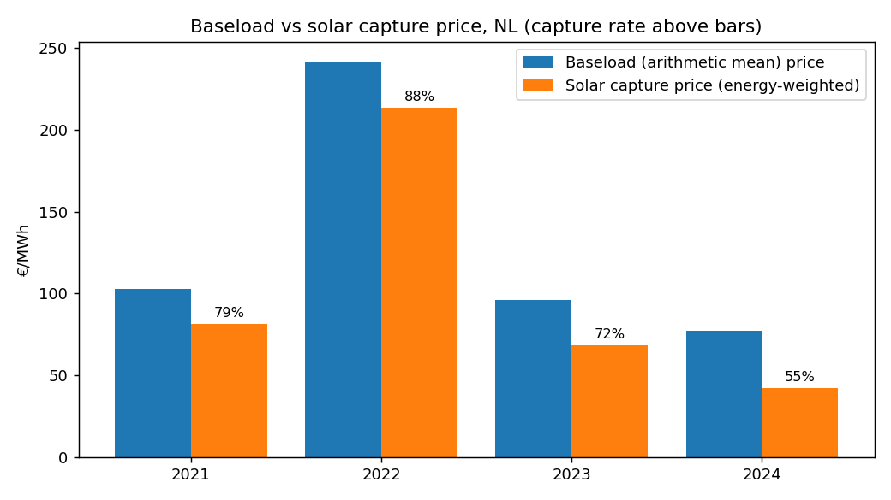
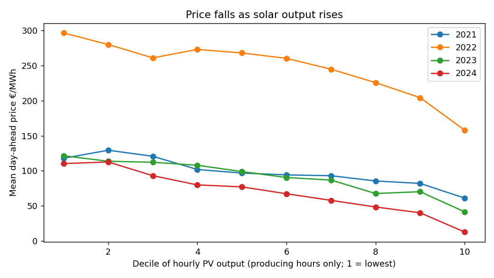
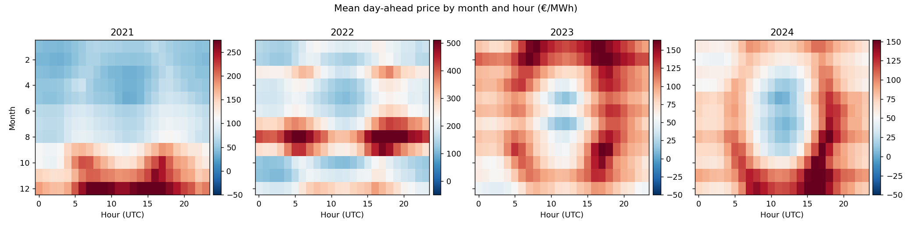
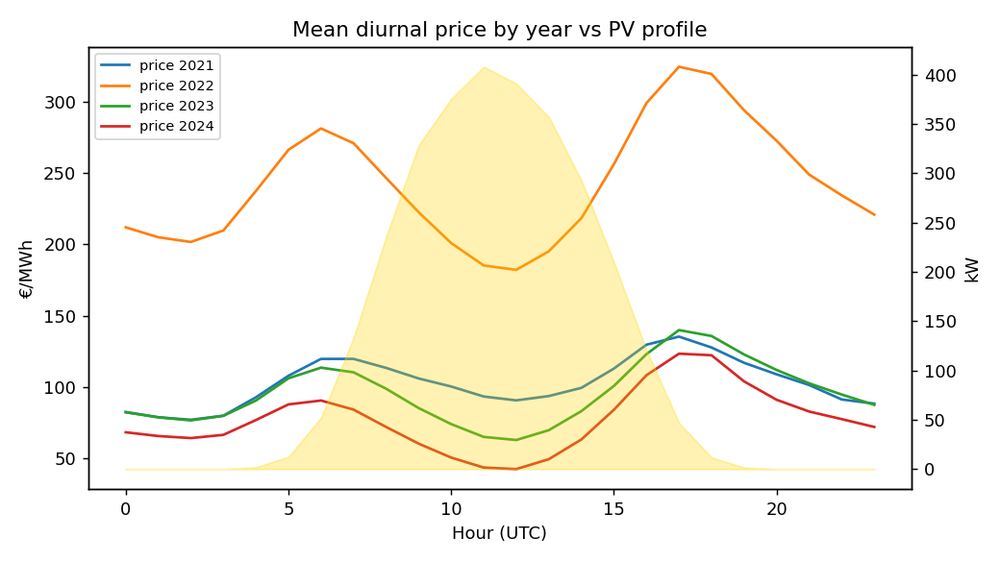
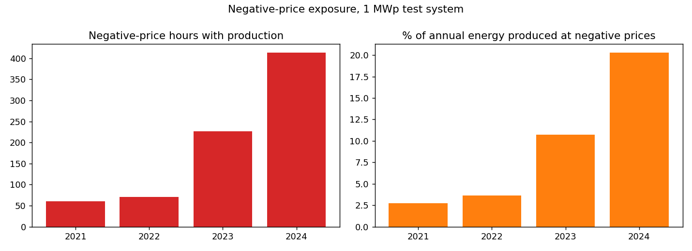
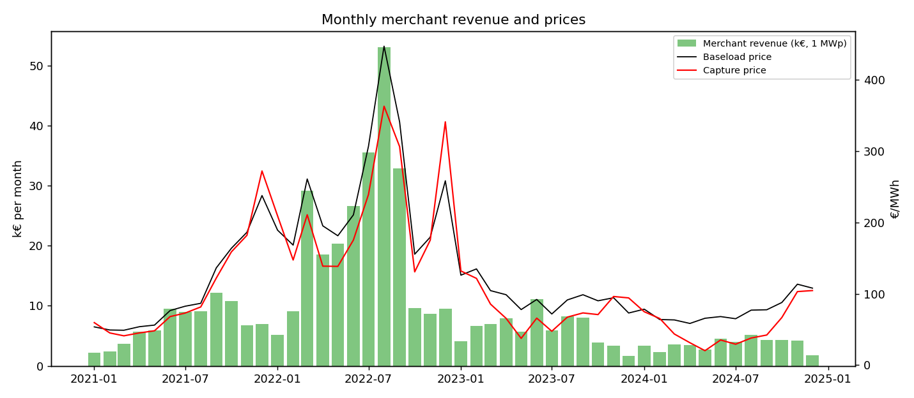

# Stage 2 — Solar Capture Price & Merchant Revenue (2021–2024)

_Generated 2026-11-15 by `scripts/build_stage2_report.py` from `stage2_results.json`._

> **Price data.** Prices: Energy-Charts (Bundesnetzagentur | SMARD.de, CC BY 4.0); not independently cross-checked against ENTSO-E. Every € and €/MWh figure below depends on these prices. The structural checks in the data audit passed; the values have not been compared with the official ENTSO-E series.

**Labels:** **[Verified]** = computed identity or data-structure check; **[Price-dependent]** = depends on the Energy-Charts prices; **[Modelled]** = PVGIS output; **[Assumed]** = our choice for a hypothetical project.

**[Assumed]** System: 1000 kWp hypothetical test system (52.45° N, 5.70° E, 35° tilt, south, 14 % losses). Production: PVGIS 6, nulls filled with KNMI month-hour ratio proxy **[Modelled]**. No grid fees, imbalance costs, subsidies, curtailment orders or degradation are included — this is gross day-ahead market value, not project revenue.

## 1. Baseload price vs solar capture price

Baseload price p̄ = arithmetic mean of all hourly prices. Capture price = Σ E·p / Σ E (energy-weighted). Capture rate = capture / baseload.

| Year | Energy MWh | Baseload €/MWh | Capture €/MWh | Capture rate | Discount €/MWh | Revenue € | Identity p̄+Cov/Ē | Spearman(E,p) |
|---|---|---|---|---|---|---|---|---|
| 2021 | 1035.471 | 102.971 | 81.378 | 0.7903 | 21.593 | 84,265 | 81.378 | -0.2895 |
| 2022 | 1209.451 | 241.91 | 213.48 | 0.8825 | 28.43 | 258,193 | 213.48 | -0.2639 |
| 2023 | 1073.241 | 95.818 | 68.518 | 0.7151 | 27.299 | 73,537 | 68.518 | -0.4685 |
| 2024 | 1033.261 | 77.289 | 42.379 | 0.5483 | 34.91 | 43,788 | 42.379 | -0.5819 |

**[Verified]** The identity column reproduces the capture price exactly in every year. **[Price-dependent]** Capture rate by year: 2021: 79%, 2022: 88%, 2023: 72%, 2024: 55% — not a steady decline (2022 was the highest), but the last two years are the lowest. Discount (€/MWh): 2021: 21.6, 2022: 28.4, 2023: 27.3, 2024: 34.9. Spearman correlation of hourly production and price (producing hours): 2021: -0.2895, 2022: -0.2639, 2023: -0.4685, 2024: -0.5819.

**What it means for a bank:** a forecast of *baseload* prices is not a forecast of solar revenue. In the latest year the plant earned 55% of the average market price. A lender's revenue case for a merchant solar project has to be built on capture prices, and their downward trend over these four years is a risk factor in its own right.

## 2. Relationship between solar production and price

Mean price by decile of hourly PV output (producing hours):

| Year | D1 | D2 | D3 | D4 | D5 | D6 | D7 | D8 | D9 | D10 |
|---|---|---|---|---|---|---|---|---|---|---|
| 2021 | 117.88 | 129.37 | 120.72 | 101.89 | 96.81 | 94.17 | 93.01 | 85.49 | 82.04 | 61.03 |
| 2022 | 296.62 | 280.22 | 261.14 | 273.27 | 268.16 | 260.44 | 244.95 | 225.81 | 204.36 | 157.87 |
| 2023 | 121.49 | 113.64 | 112.2 | 107.89 | 98.93 | 90.41 | 86.79 | 67.57 | 70.19 | 41.42 |
| 2024 | 110.33 | 112.59 | 93.04 | 79.87 | 77.07 | 67.24 | 57.85 | 48.37 | 40.09 | 12.61 |

Decomposition of the capture discount (law of total covariance, groups = month × UTC hour) **[Verified identity, price-dependent values]**:

| Year | Total discount €/MWh | Timing part (between month-hour cells) | Weather part (within cells) | Timing share |
|---|---|---|---|---|
| 2021 | 21.593 | 19.926 | 1.667 | 92% |
| 2022 | 28.43 | 21.792 | 6.638 | 77% |
| 2023 | 27.299 | 23.692 | 3.608 | 87% |
| 2024 | 34.91 | 30.442 | 4.469 | 87% |

Reading: the *timing* part is the discount explained by **when** solar produces on average (season and time of day); the *weather* part is the additional discount because, at the same clock hour and month, sunnier hours coincide with lower prices. Most of the discount is timing, which is predictable; the weather part is smaller but non-zero: output in sunnier-than-usual hours is sold below the typical price for that hour and month.

**What it means for a bank:** the two must never be simulated independently. Combining production and prices from different historical days would remove the weather part of the discount (and, if profiles are misaligned, part of the timing part), overstating merchant revenue. All later stages keep production and price from the **same historical hour**.

_Heatmap colour scales differ per year (2022 prices were far higher)._

## 3. Negative-price exposure

| Year | Negative hours | …with production | MWh at negative prices | % of annual energy | Revenue in those hours € | Mean price when producing & negative | Zero-price hours with production | Revenue if switched off at p<0 € | Gain € |
|---|---|---|---|---|---|---|---|---|---|
| 2021 | 70 | 60 | 28.55 | 2.757 | -476 | -17.13 | 8 | 84,741 | 476 |
| 2022 | 86 | 71 | 43.759 | 3.618 | -2,140 | -41.24 | 20 | 260,333 | 2,140 |
| 2023 | 315 | 227 | 115.16 | 10.73 | -4,951 | -35.55 | 36 | 78,488 | 4,951 |
| 2024 | 458 | 413 | 209.328 | 20.259 | -5,060 | -20.52 | 62 | 48,848 | 5,060 |

Reading **[Price-dependent]**: in 2024 20.259 % of the plant's energy was produced in negative-price hours. The direct revenue loss in those hours is modest because most negative prices were only slightly below zero (mean -20.52 €/MWh when producing), but that energy earned nothing. Switching off at negative prices **[Assumed operational ability]** would have raised 2024 revenue by 5,060 € (11.6 %).

**What it means for a bank:** the larger risk is not the negative price itself but the growing share of output that earns ≈ 0. This is also why PPA negative-price clauses (Stage 3) matter: they decide who bears these hours.

## 4. Monthly and seasonal patterns

| Year | Lowest month | € | Highest month | € | Months with negative revenue |
|---|---|---|---|---|---|
| 2021 | 2021-01 | 2,235 | 2021-09 | 12,184 | 0 |
| 2022 | 2022-01 | 5,141 | 2022-08 | 53,097 | 0 |
| 2023 | 2023-12 | 1,674 | 2023-06 | 11,072 | 0 |
| 2024 | 2024-12 | 1,749 | 2024-08 | 5,186 | 0 |

Share of annual energy vs revenue by season (DJF = Dec–Feb of the same calendar year):

| Year | DJF energy/revenue % | MAM | JJA | SON |
|---|---|---|---|---|
| 2021 | 11.3 / 13.9 | 32.7 / 18.1 | 36.2 / 32.8 | 19.8 / 35.2 |
| 2022 | 9.4 / 9.2 | 34.6 / 26.3 | 36.9 / 44.6 | 19.0 / 19.8 |
| 2023 | 9.6 / 16.8 | 33.1 / 28.1 | 38.7 / 34.3 | 18.6 / 20.7 |
| 2024 | 9.4 / 17.0 | 31.7 / 22.3 | 38.7 / 31.2 | 20.2 / 29.5 |

Months where capture price exceeded baseload (capture rate > 1): 2021-01, 2021-12, 2022-01, 2022-12, 2023-01, 2023-11, 2023-12, 2024-02. All are November–February months. This is consistent with the heatmaps (in winter the cheapest hours are at night, not midday), but we have not tested a mechanism.

**What it means for a bank:** revenue is concentrated in a few months and the seasonal mix changes from year to year (e.g. autumn 2021 or summer 2022). Project debt is typically repaid on a fixed periodic schedule, so the timing of cash relative to payment dates matters — a point for Stage 3.

## 5. What drove revenue changes between years? (LMDI decomposition)

| Change | Revenue Δ € | Δ % | Volume (weather) effect € | Price effect € | Energy Δ % | Capture price Δ % |
|---|---|---|---|---|---|---|
| 2021->2022 | 173,929 | 206.41 | 24,124 | 149,805 | 16.8 | 162.33 |
| 2022->2023 | -184,657 | -71.52 | -17,567 | -167,090 | -11.26 | -67.9 |
| 2023->2024 | -29,748 | -40.45 | -2,178 | -27,569 | -3.73 | -38.15 |

**[Verified]** volume + price effects sum exactly to the revenue change. **What it means for a bank:** over these years, price movements dominated weather by an order of magnitude. For merchant revenue, price risk is the first-order risk; production risk is second-order — which is precisely the risk a fixed-price PPA transfers.

## 6. PVGIS 5.3 vs PVGIS 6 — effect on revenue (2021–2023)

| Year | Revenue 5.3 € | Revenue 6 € | Revenue Δ % | Energy Δ % | Capture 5.3 | Capture 6 | Capture Δ €/MWh |
|---|---|---|---|---|---|---|---|
| 2021 | 80,469 | 84,265 | 4.72 | 4.39 | 81.126 | 81.378 | 0.252 |
| 2022 | 246,973 | 258,193 | 4.54 | 4.09 | 212.559 | 213.48 | 0.921 |
| 2023 | 69,971 | 73,537 | 5.1 | 4.44 | 68.09 | 68.518 | 0.428 |

Both series with comparable missing-data handling (5.3 zeroed records → missing → same proxy fill). Revenue differs slightly more than energy, i.e. PVGIS 6's extra energy falls in slightly higher-priced hours on average; this is consistent with its relative difference being largest in winter months (Stage 1), but not separately tested. **What it means for a bank:** the choice of production model moves revenue by ~5 %, a level effect that should be carried as a sensitivity, not resolved by picking the more favourable version.

## 7. Missing-data treatment — does it change the answer?

| Treatment | Year | Energy MWh | Revenue € | Capture €/MWh | Hours dropped |
|---|---|---|---|---|---|
| pv6_proxy_filled | 2021 | 1035.471 | 84,265 | 81.378 | 0 |
| pv6_proxy_filled | 2022 | 1209.451 | 258,193 | 213.48 | 0 |
| pv6_proxy_filled | 2023 | 1073.241 | 73,537 | 68.518 | 0 |
| pv6_proxy_filled | 2024 | 1033.261 | 43,788 | 42.379 | 0 |
| pv6_nulls_as_zero | 2021 | 1033.362 | 84,010 | 81.298 | 0 |
| pv6_nulls_as_zero | 2022 | 1205.508 | 257,158 | 213.319 | 0 |
| pv6_nulls_as_zero | 2023 | 1071.193 | 73,355 | 68.48 | 0 |
| pv6_nulls_as_zero | 2024 | 1030.537 | 43,591 | 42.3 | 0 |
| pv6_complete_case | 2021 | 1033.362 | 84,010 | 81.298 | 6 |
| pv6_complete_case | 2022 | 1205.508 | 257,158 | 213.319 | 12 |
| pv6_complete_case | 2023 | 1071.193 | 73,355 | 68.48 | 8 |
| pv6_complete_case | 2024 | 1030.537 | 43,591 | 42.3 | 7 |
| pv53_raw | 2021 | 989.888 | 80,226 | 81.046 | 0 |
| pv53_raw | 2022 | 1158.107 | 245,978 | 212.397 | 0 |
| pv53_raw | 2023 | 1025.67 | 69,798 | 68.051 | 0 |
| pv53_zeros_fixed | 2021 | 991.905 | 80,469 | 81.126 | 0 |
| pv53_zeros_fixed | 2022 | 1161.904 | 246,973 | 212.559 | 0 |
| pv53_zeros_fixed | 2023 | 1027.633 | 69,971 | 68.09 | 0 |

Notes: *complete case* and *nulls as zero* give identical sums by construction (dropping an hour from Σ E·p and Σ E is the same as adding 0); they differ only in what they claim. The primary treatment fills PVGIS 6 nulls with a KNMI-based month×hour ratio proxy. Differences between treatments are ≤ 0.5 % in revenue and < 0.1 €/MWh in capture price. **[Verified]** The conclusion is robust to the missing-data treatment; for PVGIS 5.3 the zero-encoding, if uncorrected, understates energy by ~2–4 MWh/yr.

## 8. Limitations

- Prices not independently cross-checked against ENTSO-E.
- Gross day-ahead value only: no imbalance costs, grid tariffs, profile/balancing fees, subsidies (e.g. SDE++), grid-operator curtailment, availability or degradation.
- Price-taker assumption: a 1 MWp plant does not move prices; national solar build-out does, and that is already in the historical prices.
- Four years are four different market regimes; no statement here is a forecast.
- Capture prices are **realised** values for a modelled plant, not estimates from a sample — sampling confidence intervals would answer the wrong question. The uncertainty that matters (future years) is explored with stress scenarios in Stage 3.
