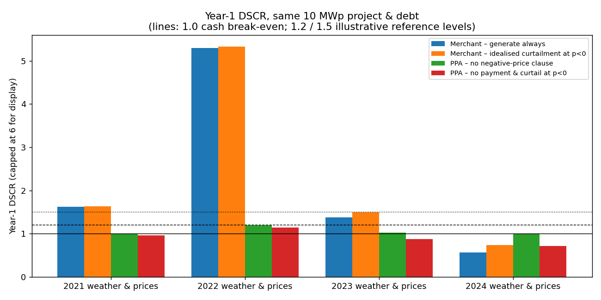
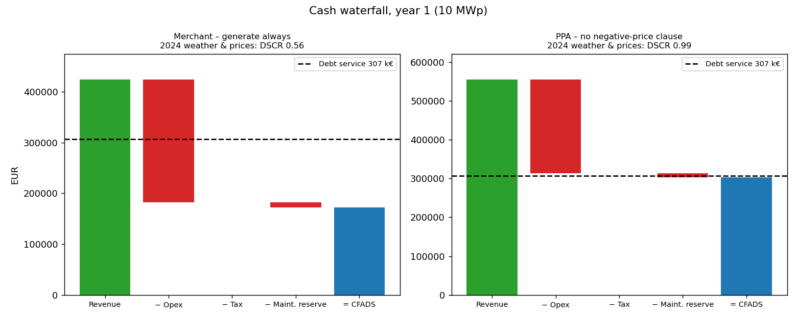
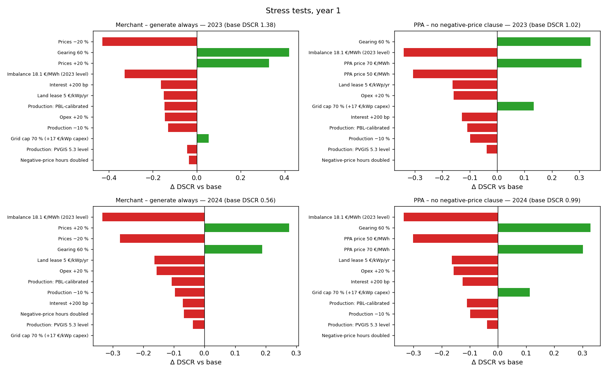
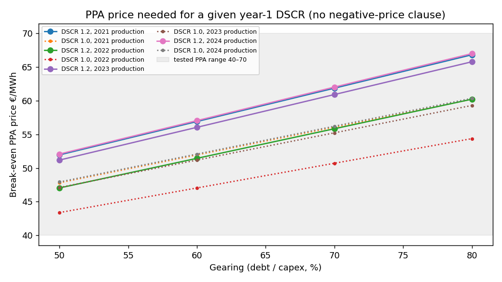
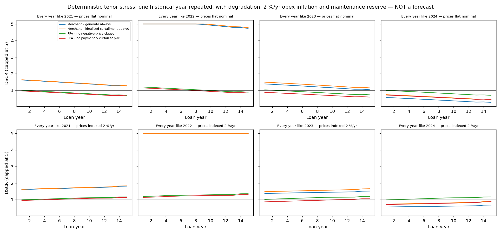

# Stage 3 — Project-Finance Model: CFADS, Debt Service, DSCR

_Generated 2026-11-15 by `scripts/build_stage3_report.py`; numbers read from `stage3_results.json`._

> **Prices: Energy-Charts (Bundesnetzagentur | SMARD.de, CC BY 4.0); not independently cross-checked against ENTSO-E.** All merchant results and every comparison depend on these prices. Financing terms are public benchmarks (PBL SDE++ 2025, designed for **subsidised** projects) or illustrative values. **Nothing here is a bank's lending term, a real project's cost, a financing recommendation, or a probability of default.**

## 1. The hypothetical project

| Item | Value | Status | Source |
|---|---|---|---|
| latitude | 52.45 deg | illustrative | Hypothetical site used in Stages 1–2 (near Biddinghuizen) |
| longitude | 5.7 deg | illustrative | Hypothetical site used in Stages 1–2 |
| dc_capacity_kwp | 10000 kWp | sourced | PBL Eindadvies SDE++ 2025, Tabel 5.23 p.81: reference installation ≥1 MWp <20 MWp grondgebonden = 10.000 kWp |
| inverter_ac_fraction_of_dc | 0.7 kWac/kWp | sourced | PBL SDE++ 2025 p.70 §5.1.14: inverter costs based on inverter capacity of 70% of peak power |
| grid_export_fraction_of_dc | 0.5 kW/kWp | sourced | PBL SDE++ 2025 p.72 & Tabel 5.23 '(net=50%)': most solar categories assume grid connection at 50% of peak power |
| configuration | fixed-tilt, south-facing, 35°, monofacial c-Si, free-standing | illustrative | Kept identical to Stages 1–2 so the verified PVGIS 6 series is reused; Dutch parks often use lower tilt/east-west (limitation) |
| operating_life_years | 25 years | illustrative | Assumption. PBL uses a 20-year analysis period (p.75 §5.1.19); only the debt tenor (15 y) enters the DSCR analysis |
| degradation_per_year | 0.0064 fraction/yr | sourced | PBL SDE++ 2025 p.76 §5.1.23: 0,64% average annual power/production decline. (Jordan & Kurtz 2013 median 0.5%/yr as cross-reference) |

**Capacity units.** 10,000 kWp = 10 MWp **DC** (module nameplate). Inverters 7 MWac (70 %). Grid export capped at 5 MW (50 %), applied as hourly clipping: E_t = min(PV_t × 10,000 kWp, 5,000 kW) × 1 h.

## 2. Assumption register

| Section | Parameter | Value | Status | Source |
|---|---|---|---|---|
| costs | capex_eur_per_kwp | 426 EUR/kWp | sourced | PBL SDE++ 2025 Tabel 5.23 p.81 (SDE++ 2025 column) |
| costs | fixed_opex_eur_per_kwp_yr | 15.9 EUR/kWp/yr | sourced | PBL SDE++ 2025 Tabel 5.23 p.81 / Tabel 5.10b p.74 (O&M 4.0, green maintenance 1.5, nature-inclusive 2.9, insurance 2.5, security 0.5, grid connection 2.0, curtailment equipment 0.1, asset mgmt 1.0, property tax 1.4). Excludes land lease (p.73) |
| costs | variable_opex_eur_per_mwh | 1.9 EUR/MWh | sourced | PBL SDE++ 2025 Tabel 5.23 p.81: 0,0019 EUR/kWh (before erratum) |
| costs | imbalance_cost_eur_per_mwh | 7.0 EUR/MWh | sourced | PBL erratum 6 June 2025 p.4: long-term imbalance cost 0,0070 EUR/kWh for solar; variable O&M becomes 0,0089 EUR/kWh |
| costs | imbalance_cost_stress_eur_per_mwh | 18.1 EUR/MWh | sourced | PBL erratum 6 June 2025 p.4: calculated 2023 imbalance cost for solar 0,0181 EUR/kWh |
| costs | land_lease_eur_per_kwp_yr | 0.0 EUR/kWp/yr | illustrative | PBL excludes land/roof rent by design (p.73). Real projects pay it: tested in sensitivity (0–10 EUR/kWp/yr illustrative) |
| costs | inverter_replacement_eur | 130000 EUR (year 13) | sourced | PBL SDE++ 2025 Tabel 5.23 p.81: eenmalige O&M-kosten in jaar 13 = 130.000 EUR |
| costs | opex_inflation | 0.02 fraction/yr | sourced | PBL SDE++ 2025 p.33 §3.1.5: 2,0% per year |
| financing | gearing_debt_share | 0.8 debt/capex | sourced | PBL SDE++ 2025 p.32 §3.1.3: 80% debt / 20% equity for zon-pv. CAVEAT: for SDE++-subsidised projects; an unsubsidised project would likely support less debt (tested) |
| financing | interest_rate | 0.04 nominal p.a. | sourced | PBL SDE++ 2025 p.29: total nominal interest for solar & wind loans ≈ 4,0% (10-y IRS ~2,4–2,5% + 1,5% margin) |
| financing | tenor_years | 15 years | sourced | PBL SDE++ 2025 p.33 §3.1.6: loan term assumed equal to 15-year subsidy period |
| financing | repayment | annuity | illustrative | Design choice: simplest transparent repayment profile; sculpted repayment illustrated in the Stage 3 report |
| financing | tax_rate | 0.258 fraction | sourced | PBL SDE++ 2025 p.32 §3.1.4: marginal corporate tax rate 25,8% |
| financing | depreciation_years | 15 years | sourced | PBL SDE++ 2025 p.33 §3.1.6: depreciation term equal to subsidy period |
| financing | return_on_equity_reference | 0.09 nominal p.a. | sourced | PBL SDE++ 2025 p.31: 9,0% for zon-pv (reference only; not used in DSCR) |
| financing | dsra_months | 6 months of debt service | illustrative | Secondary/training sources describe ~6-month DSRA as typical; not verified against term sheets |
| financing | dscr_reference_levels | [1.0, 1.2, 1.5] x | illustrative | 1.00 = cash break-even; 1.20 ≈ often-cited contracted level; 1.50 ≈ often-cited merchant level (secondary/training sources, unverified). Reference lines only — not covenants of any real lender |
| ppa | structure | fixed-price, pay-as-produced, physical/virtual neutral | illustrative | Design choice |
| ppa | price_eur_per_mwh | 60.0 EUR/MWh | illustrative | No verified Dutch solar PPA price. Reference only: LevelTen Market-Averaged Continental Solar Index €63.64/MWh (Q3 2024) and €62.31/MWh (Q4 2024), offers across 22 European countries, as reported by PV Tech (17 Oct 2024; 30 Jan 2025). Base rounded down; range tested |
| ppa | price_range_eur_per_mwh | [40, 45, 50, 55, 60, 65, 70] EUR/MWh | illustrative | Sensitivity grid |
| ppa | tenor_years | 15 years | illustrative | Set equal to debt tenor for a clean comparison; shorter tenors leave a merchant tail (not modelled) |
| ppa | indexation | 0.0 fraction/yr | illustrative | Flat nominal price (common, conservative vs inflating opex) |
| ppa | negative_price_clause | ['none', 'no_payment_and_curtail'] | illustrative | Two generic clause types; real contracts vary |
| ppa | imbalance_borne_by_project | True | illustrative | Kept with the project in BOTH cases so the comparison isolates price risk; in practice often passed through as a PPA price discount |

## 3. Debt

Capex 4,260 k€ = debt 3,408 k€ (80 %) + equity 852 k€. Annuity at 4.0 % over 15 years: **306,519 € per year**.

| Year | Opening balance | Interest | Principal | Debt service | Closing |
|---|---|---|---|---|---|
| 1 | 3,408 | 136 | 170 | 307 | 3,238 |
| 2 | 3,238 | 130 | 177 | 307 | 3,061 |
| 8 | 2,064 | 83 | 224 | 307 | 1,840 |
| 14 | 578 | 23 | 283 | 307 | 295 |
| 15 | 295 | 12 | 295 | 307 | 0 |
_(k€)_

## 4. Production cross-checks

| Year | Unclipped kWh/kWp | Clipped at 50 % grid | Clipped at 70 % | PBL reference (50 %) |
|---|---|---|---|---|
| 2021 | 1035.5 | 926.4 | 1019.0 | 855 |
| 2022 | 1209.5 | 1045.5 | 1181.5 | 855 |
| 2023 | 1073.2 | 943.4 | 1050.4 | 855 |
| 2024 | 1033.3 | 923.7 | 1018.1 | 855 |

Our hourly-clipped PVGIS 6 yield is above PBL's 855 h. Two alternative production levels are carried as **model uncertainty**: PVGIS 5.3 level (× 0.9588) and PBL-calibrated (× 0.8899 on hourly output before clipping, so that the 2021–24 mean clipped year-1 yield = 894.0 kWh/kWp, the year-1 equivalent of PBL's 15-year average of 855 h (855 ÷ mean degradation factor 0.9564)).

**Validation:** with the grid cap removed, Stage 3 merchant revenue equals exactly 10 × the Stage 2 1 MWp revenue in every year:

| Year | Stage 3 (no cap) € | 10 × Stage 2 € |
|---|---|---|
| 2021 | 842,648 | 842,648 |
| 2022 | 2,581,931 | 2,581,931 |
| 2023 | 735,366 | 735,366 |
| 2024 | 437,884 | 437,884 |

## 5. Year-1 cash waterfall — each historical year replayed as operating year 1

Cash revenue → − opex → **operating cash flow (EBITDA)** → − tax → − maintenance reserve → **CFADS** ÷ **debt service** = DSCR.

**2021 weather & prices**

| Contract | MWh sold | €/MWh realised | Revenue k€ | Opex k€ | EBITDA k€ | Tax k€ | MRA k€ | CFADS k€ | DS k€ | DSCR |
|---|---|---|---|---|---|---|---|---|---|---|
| Merchant | 9,264 | 83.8 | 776 | 241 | 535 | 30 | 10 | 495 | 307 | **1.62** |
| Merchant + curtail | 9,039 | 86.3 | 780 | 239 | 541 | 31 | 10 | 500 | 307 | **1.63** |
| PPA (no clause) | 9,264 | 60.0 | 556 | 241 | 314 | 0 | 10 | 304 | 307 | **0.99** |
| PPA (no pay & curtail) | 9,039 | 60.0 | 542 | 239 | 303 | 0 | 10 | 293 | 307 | **0.96** |

**2022 weather & prices**

| Contract | MWh sold | €/MWh realised | Revenue k€ | Opex k€ | EBITDA k€ | Tax k€ | MRA k€ | CFADS k€ | DS k€ | DSCR |
|---|---|---|---|---|---|---|---|---|---|---|
| Merchant | 10,455 | 220.6 | 2,307 | 252 | 2,055 | 422 | 10 | 1,623 | 307 | **5.29** |
| Merchant + curtail | 10,132 | 229.1 | 2,321 | 249 | 2,072 | 426 | 10 | 1,636 | 307 | **5.34** |
| PPA (no clause) | 10,455 | 60.0 | 627 | 252 | 375 | 0 | 10 | 365 | 307 | **1.19** |
| PPA (no pay & curtail) | 10,132 | 60.0 | 608 | 249 | 359 | 0 | 10 | 349 | 307 | **1.14** |

**2023 weather & prices**

| Contract | MWh sold | €/MWh realised | Revenue k€ | Opex k€ | EBITDA k€ | Tax k€ | MRA k€ | CFADS k€ | DS k€ | DSCR |
|---|---|---|---|---|---|---|---|---|---|---|
| Merchant | 9,434 | 72.1 | 680 | 243 | 437 | 4 | 10 | 423 | 307 | **1.38** |
| Merchant + curtail | 8,542 | 83.9 | 717 | 235 | 482 | 16 | 10 | 456 | 307 | **1.49** |
| PPA (no clause) | 9,434 | 60.0 | 566 | 243 | 323 | 0 | 10 | 313 | 307 | **1.02** |
| PPA (no pay & curtail) | 8,542 | 60.0 | 513 | 235 | 278 | 0 | 10 | 268 | 307 | **0.87** |

**2024 weather & prices**

| Contract | MWh sold | €/MWh realised | Revenue k€ | Opex k€ | EBITDA k€ | Tax k€ | MRA k€ | CFADS k€ | DS k€ | DSCR |
|---|---|---|---|---|---|---|---|---|---|---|
| Merchant | 9,237 | 45.9 | 424 | 241 | 182 | 0 | 10 | 172 | 307 | **0.56** |
| Merchant + curtail | 7,563 | 60.9 | 461 | 226 | 234 | 0 | 10 | 224 | 307 | **0.73** |
| PPA (no clause) | 9,237 | 60.0 | 554 | 241 | 313 | 0 | 10 | 303 | 307 | **0.99** |
| PPA (no pay & curtail) | 7,563 | 60.0 | 454 | 226 | 227 | 0 | 10 | 217 | 307 | **0.71** |

## 6. Production model uncertainty → DSCR

| Production case | Year | Merchant | Merchant + curtail | PPA (no clause) | PPA (no pay & curtail) |
|---|---|---|---|---|---|
| PVGIS 6 (base) | 2021 | 1.62 | 1.63 | 0.99 | 0.96 |
| PVGIS 6 (base) | 2022 | 5.29 | 5.34 | 1.19 | 1.14 |
| PVGIS 6 (base) | 2023 | 1.38 | 1.49 | 1.02 | 0.87 |
| PVGIS 6 (base) | 2024 | 0.56 | 0.73 | 0.99 | 0.71 |
| PVGIS 5.3 level | 2021 | 1.57 | 1.58 | 0.95 | 0.92 |
| PVGIS 5.3 level | 2022 | 5.16 | 5.20 | 1.15 | 1.10 |
| PVGIS 5.3 level | 2023 | 1.33 | 1.44 | 0.98 | 0.84 |
| PVGIS 5.3 level | 2024 | 0.52 | 0.69 | 0.95 | 0.68 |
| PBL 855 h calibrated | 2021 | 1.48 | 1.50 | 0.88 | 0.85 |
| PBL 855 h calibrated | 2022 | 4.91 | 4.95 | 1.08 | 1.03 |
| PBL 855 h calibrated | 2023 | 1.23 | 1.36 | 0.91 | 0.77 |
| PBL 855 h calibrated | 2024 | 0.46 | 0.62 | 0.88 | 0.61 |

Break-even PPA price (no clause) by production case, €/MWh, for DSCR 1.0 / 1.2:

| Production case | 2021 | 2022 | 2023 | 2024 |
|---|---|---|---|---|
| PVGIS 6 (base) | 60.2 / 66.8 | 54.4 / 60.2 | 59.3 / 65.8 | 60.4 / 67.0 |
| PVGIS 5.3 level | 61.6 / 68.3 | 55.4 / 61.4 | 60.6 / 67.2 | 61.7 / 68.5 |
| PBL 855 h calibrated | 64.2 / 71.3 | 57.4 / 63.7 | 63.1 / 70.0 | 64.3 / 71.5 |

## 7. Stress tests (year-1 DSCR)

**2021**

| Stress | Merchant | Merchant + curtail | PPA (no clause) | PPA (no pay & curtail) |
|---|---|---|---|---|
| Base | 1.62 | 1.63 | 0.99 | 0.96 |
| Production: PVGIS 5.3 level | 1.57 | 1.58 | 0.95 | 0.92 |
| Production: PBL-calibrated | 1.48 | 1.50 | 0.88 | 0.85 |
| Production −10 % | 1.49 | 1.51 | 0.89 | 0.86 |
| Opex +20 % | 1.50 | 1.51 | 0.84 | 0.80 |
| Imbalance 18.1 €/MWh (2023 level) | 1.37 | 1.39 | 0.66 | 0.63 |
| Land lease 5 €/kWp/yr | 1.50 | 1.51 | 0.83 | 0.79 |
| Interest +200 bp | 1.46 | 1.47 | 0.87 | 0.83 |
| Gearing 60 % | 2.12 | 2.14 | 1.32 | 1.27 |
| Grid cap 70 % (+17 €/kWp capex) | 1.68 | 1.70 | 1.10 | 1.06 |
| Prices −20 % | 1.21 | 1.22 | — | — |
| Prices +20 % | 1.99 | 2.01 | — | — |
| Negative-price hours doubled | 1.61 | 1.63 | 0.99 | 0.94 |
| PPA price 50 €/MWh | — | — | 0.69 | 0.66 |
| PPA price 70 €/MWh | — | — | 1.29 | 1.25 |

**2022**

| Stress | Merchant | Merchant + curtail | PPA (no clause) | PPA (no pay & curtail) |
|---|---|---|---|---|
| Base | 5.29 | 5.34 | 1.19 | 1.14 |
| Production: PVGIS 5.3 level | 5.16 | 5.20 | 1.15 | 1.10 |
| Production: PBL-calibrated | 4.91 | 4.95 | 1.08 | 1.03 |
| Production −10 % | 4.95 | 4.99 | 1.09 | 1.04 |
| Opex +20 % | 5.17 | 5.22 | 1.03 | 0.97 |
| Imbalance 18.1 €/MWh (2023 level) | 5.01 | 5.06 | 0.81 | 0.77 |
| Land lease 5 €/kWp/yr | 5.17 | 5.21 | 1.03 | 0.97 |
| Interest +200 bp | 4.67 | 4.71 | 1.04 | 0.99 |
| Gearing 60 % | 7.02 | 7.08 | 1.59 | 1.52 |
| Grid cap 70 % (+17 €/kWp capex) | 5.63 | 5.68 | 1.36 | 1.30 |
| Prices −20 % | 4.18 | 4.21 | — | — |
| Prices +20 % | 6.41 | 6.46 | — | — |
| Negative-price hours doubled | 5.28 | 5.34 | 1.19 | 1.10 |
| PPA price 50 €/MWh | — | — | 0.85 | 0.81 |
| PPA price 70 €/MWh | — | — | 1.48 | 1.44 |

**2023**

| Stress | Merchant | Merchant + curtail | PPA (no clause) | PPA (no pay & curtail) |
|---|---|---|---|---|
| Base | 1.38 | 1.49 | 1.02 | 0.87 |
| Production: PVGIS 5.3 level | 1.33 | 1.44 | 0.98 | 0.84 |
| Production: PBL-calibrated | 1.23 | 1.36 | 0.91 | 0.77 |
| Production −10 % | 1.25 | 1.38 | 0.92 | 0.78 |
| Opex +20 % | 1.23 | 1.37 | 0.86 | 0.72 |
| Imbalance 18.1 €/MWh (2023 level) | 1.05 | 1.23 | 0.68 | 0.56 |
| Land lease 5 €/kWp/yr | 1.23 | 1.37 | 0.86 | 0.71 |
| Interest +200 bp | 1.22 | 1.34 | 0.89 | 0.76 |
| Gearing 60 % | 1.80 | 1.95 | 1.36 | 1.16 |
| Grid cap 70 % (+17 €/kWp capex) | 1.43 | 1.56 | 1.15 | 0.98 |
| Prices −20 % | 0.95 | 1.07 | — | — |
| Prices +20 % | 1.71 | 1.83 | — | — |
| Negative-price hours doubled | 1.34 | 1.50 | 1.02 | 0.79 |
| PPA price 50 €/MWh | — | — | 0.71 | 0.59 |
| PPA price 70 €/MWh | — | — | 1.33 | 1.15 |

**2024**

| Stress | Merchant | Merchant + curtail | PPA (no clause) | PPA (no pay & curtail) |
|---|---|---|---|---|
| Base | 0.56 | 0.73 | 0.99 | 0.71 |
| Production: PVGIS 5.3 level | 0.52 | 0.69 | 0.95 | 0.68 |
| Production: PBL-calibrated | 0.46 | 0.62 | 0.88 | 0.61 |
| Production −10 % | 0.47 | 0.63 | 0.89 | 0.62 |
| Opex +20 % | 0.41 | 0.58 | 0.83 | 0.56 |
| Imbalance 18.1 €/MWh (2023 level) | 0.23 | 0.46 | 0.65 | 0.44 |
| Land lease 5 €/kWp/yr | 0.40 | 0.57 | 0.82 | 0.55 |
| Interest +200 bp | 0.49 | 0.64 | 0.86 | 0.62 |
| Gearing 60 % | 0.75 | 0.98 | 1.32 | 0.95 |
| Grid cap 70 % (+17 €/kWp capex) | 0.56 | 0.77 | 1.10 | 0.78 |
| Prices −20 % | 0.29 | 0.43 | — | — |
| Prices +20 % | 0.84 | 1.03 | — | — |
| Negative-price hours doubled | 0.49 | 0.75 | 0.99 | 0.55 |
| PPA price 50 €/MWh | — | — | 0.69 | 0.46 |
| PPA price 70 €/MWh | — | — | 1.29 | 0.96 |

## 8. Break-even analysis

| Year | Merchant capture €/MWh (clipped) | Capture needed DSCR 1.0 | Capture needed DSCR 1.2 | PPA price DSCR 1.0 (no clause / no-pay) | PPA price DSCR 1.2 (no clause / no-pay) |
|---|---|---|---|---|---|
| 2021 | 83.81 | 60.23 | 66.84 | 60.23 / 61.51 | 66.84 / 68.29 |
| 2022 | 220.62 | 54.38 | 60.24 | 54.38 / 55.83 | 60.24 / 61.88 |
| 2023 | 72.06 | 59.31 | 65.81 | 59.31 / 64.57 | 65.8 / 71.74 |
| 2024 | 45.86 | 60.38 | 67.02 | 60.38 / 71.78 | 67.02 / 79.89 |

Production level (× base) at which year-1 DSCR = 1.0:

| Year | Merchant | Merchant + curtail | PPA (no clause) | PPA (no pay & curtail) |
|---|---|---|---|---|
| 2021 | 0.634 | 0.628 | 1.007 | 1.05 |
| 2022 | 0.192 | 0.19 | 0.82 | 0.864 |
| 2023 | 0.751 | 0.685 | 0.977 | 1.167 |
| 2024 | 1.586 | 1.317 | 1.013 | 1.449 |

Debt capacity — largest gearing with year-1 DSCR ≥ 1.2 / ≥ 1.5 (rate and tenor held fixed):

| Year | Merchant | Merchant + curtail | PPA (no clause) | PPA (no pay & curtail) |
|---|---|---|---|---|
| 2021 | ≥100 % (cap) / 87 % | ≥100 % (cap) / 88 % | 66 % / 53 % | 64 % / 51 % |
| 2022 | ≥100 % (cap) / ≥100 % (cap) | ≥100 % (cap) / ≥100 % (cap) | 79 % / 64 % | 76 % / 61 % |
| 2023 | 93 % / 73 % | ≥100 % (cap) / 79 % | 68 % / 55 % | 58 % / 46 % |
| 2024 | 38 % / 30 % | 49 % / 39 % | 66 % / 53 % | 47 % / 38 % |

Break-even PPA price (no clause) vs gearing, DSCR 1.0 / 1.2:

| Year | 50% debt | 60% debt | 70% debt | 80% debt |
|---|---|---|---|---|
| 2021 | 47.8 / 52.0 | 52.0 / 56.9 | 56.1 / 61.9 | 60.2 / 66.8 |
| 2022 | 43.4 / 47.0 | 47.0 / 51.5 | 50.7 / 55.9 | 54.4 / 60.2 |
| 2023 | 47.1 / 51.2 | 51.2 / 56.1 | 55.2 / 60.9 | 59.3 / 65.8 |
| 2024 | 47.9 / 52.1 | 52.1 / 57.1 | 56.2 / 62.0 | 60.4 / 67.0 |

## 9. Annuity vs sculpted repayment (illustration, PPA no clause, flat nominal price)

| Weather year | Annuity debt (DSCR ≥ 1.2 every year) | Sculpted debt (DS_t = CFADS_t / 1.2) | Annuity gearing | Sculpted gearing |
|---|---|---|---|---|
| 2021 | 1,971 k€ | 2,422 k€ | 46 % | 57 % |
| 2022 | 2,506 k€ | 2,973 k€ | 59 % | 70 % |
| 2023 | 2,050 k€ | 2,501 k€ | 48 % | 59 % |
| 2024 | 1,961 k€ | 2,410 k€ | 46 % | 57 % |

## 10. Deterministic tenor stress (one historical year repeated for 15 years)

**Prices flat in nominal terms (real decline 2 %/yr vs opex)** — min DSCR / years < 1 / first year cumulative shortfall exceeds 6-month DSRA (no replenishment):

| Year repeated | Merchant | Merchant + curtail | PPA (no clause) | PPA (no pay & curtail) |
|---|---|---|---|---|
| 2021 | 1.26 / 0 / — | 1.27 / 0 / — | 0.69 / 15 / 7 | 0.66 / 15 / 6 |
| 2022 | 4.74 / 0 / — | 4.78 / 0 / — | 0.88 / 6 / — | 0.83 / 8 / 13 |
| 2023 | 1.03 / 0 / — | 1.14 / 0 / — | 0.72 / 14 / 9 | 0.59 / 15 / 4 |
| 2024 | 0.27 / 15 / 2 | 0.45 / 15 / 2 | 0.69 / 15 / 7 | 0.44 / 15 / 2 |

**Prices indexed 2 %/yr (flat real)** — min DSCR / years < 1 / first year cumulative shortfall exceeds 6-month DSRA (no replenishment):

| Year repeated | Merchant | Merchant + curtail | PPA (no clause) | PPA (no pay & curtail) |
|---|---|---|---|---|
| 2021 | 1.62 / 0 / — | 1.63 / 0 / — | 0.99 / 1 / — | 0.96 / 4 / — |
| 2022 | 5.29 / 0 / — | 5.34 / 0 / — | 1.19 / 0 / — | 1.14 / 0 / — |
| 2023 | 1.38 / 0 / — | 1.49 / 0 / — | 1.02 / 0 / — | 0.87 / 10 / 5 |
| 2024 | 0.56 / 15 / 2 | 0.73 / 15 / 2 | 0.99 / 1 / — | 0.71 / 15 / 2 |

## 11. Scaling benchmark (year-1 DSCR)

| Configuration | Year | Merchant | Merchant + curtail | PPA (no clause) | PPA (no pay & curtail) |
|---|---|---|---|---|---|
| 1 MWp, no grid cap (benchmark) | 2021 | 1.75 | 1.77 | 1.18 | 1.13 |
| 1 MWp, no grid cap (benchmark) | 2022 | 5.93 | 5.99 | 1.43 | 1.38 |
| 1 MWp, no grid cap (benchmark) | 2023 | 1.49 | 1.63 | 1.24 | 1.05 |
| 1 MWp, no grid cap (benchmark) | 2024 | 0.58 | 0.80 | 1.17 | 0.82 |
| 10 MWp, no grid cap (benchmark) | 2021 | 1.75 | 1.77 | 1.18 | 1.13 |
| 10 MWp, no grid cap (benchmark) | 2022 | 5.93 | 5.99 | 1.43 | 1.38 |
| 10 MWp, no grid cap (benchmark) | 2023 | 1.49 | 1.63 | 1.24 | 1.05 |
| 10 MWp, no grid cap (benchmark) | 2024 | 0.58 | 0.80 | 1.17 | 0.82 |
| 10 MWp, 70% grid cap (+17 €/kWp) | 2021 | 1.68 | 1.70 | 1.10 | 1.06 |
| 10 MWp, 70% grid cap (+17 €/kWp) | 2022 | 5.63 | 5.68 | 1.36 | 1.30 |
| 10 MWp, 70% grid cap (+17 €/kWp) | 2023 | 1.43 | 1.56 | 1.15 | 0.98 |
| 10 MWp, 70% grid cap (+17 €/kWp) | 2024 | 0.56 | 0.77 | 1.10 | 0.78 |
| 10 MWp, 50% grid cap (base) | 2021 | 1.62 | 1.63 | 0.99 | 0.96 |
| 10 MWp, 50% grid cap (base) | 2022 | 5.29 | 5.34 | 1.19 | 1.14 |
| 10 MWp, 50% grid cap (base) | 2023 | 1.38 | 1.49 | 1.02 | 0.87 |
| 10 MWp, 50% grid cap (base) | 2024 | 0.56 | 0.73 | 0.99 | 0.71 |

## 12. What this model can and cannot conclude

**Can (under stated assumptions; prices not independently cross-checked):** how year-1 CFADS and DSCR of one defined hypothetical project respond to the 2021–2024 weather-and-price years, to the contract type and negative-price clause, and to each stressed input; the break-even PPA prices, capture prices, production levels and debt capacities implied by those assumptions; which inputs matter most.

**Cannot:** estimate a probability of default or a loss (no loan-performance data, no reserve/waiver dynamics); forecast prices or capture rates; represent any lender's actual terms or any real project's costs; establish a market PPA price for the Netherlands (no verified Dutch benchmark); value counterparty credit risk of a PPA buyer; replace an independent energy yield assessment. The four historical years are four regimes, not a probability distribution.
